# 第1弾 候補（2026-10-21）

設計図（`BLUEPRINT.md`）に沿って 6 体を作成。かけ合わせの種類が偏らないよう、道具 2・物 2・概念 1・事象 1 にした。
**判定欄を書き換えて採用を決める。** 原寸画像は各リンク先（Canva）にある。

| # | 名前 | ベース（珍しい生き物） | かけ合わせ | 種類 | 判定 |
|---|---|---|---|---|---|
| 1 | ケシマジロ | ヒメアルマジロ | 消しゴム | 道具 | 候補 |
| 2 | カギアイ | アイアイ | 鍵 | 道具 | 候補 |
| 3 | フウリンダコ | メンダコ | 風鈴 | 物 | 候補 |
| 4 | チョウチンカカポ | カカポ | 提灯 | 物 | 候補 |
| 5 | ウワサミミ | オオミミトビネズミ | 噂 | 概念 | 候補 |
| 6 | ハルネ | ヤマネ | 春の訪れ | 事象 | 候補 |

---

## 1. ケシマジロ — ヒメアルマジロ × 消しゴム

| デザイン | リファレンス |
|---|---|
| 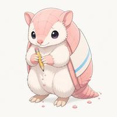 | 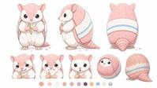 |
| [原寸](https://www.canva.com/M/MAHYoboPVzg) | [原寸](https://www.canva.com/M/MAHYoXX6cXA) |

- **生態ネタ**: ヒメアルマジロは体長 10cm ほどの世界最小のアルマジロ。ピンクの甲羅と白い毛。
- **能力**: 背中の消しゴムの甲羅でこすると、「やり直したい失敗」を 1 つだけ消せる。
- **弱点**: 使うたびに甲羅がすり減り、消しカスが出る。減りすぎると丸まれなくなる。
- **性格**: おっとり。謝りぐせがある。
- **デザインの要点**: 甲羅＝ピンクの消しゴム、背中に青ラインの紙スリーブ、小さな鉛筆を持つ。
- **配色**: 桜ピンク / クリーム白 / 淡い水色
- 初稿（複数ポーズ）: [原寸](https://www.canva.com/M/MAHYoSa090Y)

## 2. カギアイ — アイアイ × 鍵

| デザイン | リファレンス |
|---|---|
| 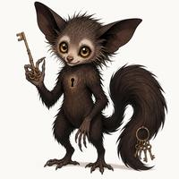 | 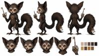 |
| [原寸](https://www.canva.com/M/MAHYobyXUXQ) | [原寸](https://www.canva.com/M/MAHYoSO_RyM) |

- **生態ネタ**: アイアイは細長い中指で木を叩き、音で中の虫を探す夜行性のサル。
- **能力**: 鍵になった中指で錠前をトントン叩き、音を聞いてどんな扉も開ける。
- **弱点**: 開けた扉の「中の秘密」まで聞こえてしまい、黙っているのがつらい。
- **性格**: 無口、好奇心旺盛。口に指を当てる「しーっ」が決めポーズ。
- **デザインの要点**: 中指が真鍮の鍵、胸に鍵穴マーク、しっぽの先に鍵束。
- **配色**: ココアブラウン / 真鍮ゴールド / 月明かりのクリーム
- ⚠️ 他の 5 体よりリアル寄りの画風で出た。シリーズで並べるなら再生成が必要。

## 3. フウリンダコ — メンダコ × 風鈴

| デザイン | リファレンス |
|---|---|
| 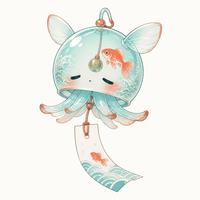 | 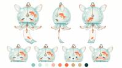 |
| [原寸](https://www.canva.com/M/MAHYoVV4hsU) | [原寸](https://www.canva.com/M/MAHYoYQg5-U) |

- **生態ネタ**: メンダコは深海にすむ平たいタコ。耳のようなヒレで泳ぐ。
- **能力**: 耳ヒレが揺れると風鈴が鳴り、まわりの気温が少し下がる。
- **弱点**: 深海育ちで地上の暑さに弱い。ガラスの体なので落とすと割れる。
- **性格**: のんびり、恥ずかしがり。照れると短冊がパタパタ揺れる。
- **デザインの要点**: 体がガラスの風鈴（金魚と波の絵付け）、中に舌（ぜつ）、足元から短冊。
- **配色**: 珊瑚オレンジ / ガラスの水色 / 白

## 4. チョウチンカカポ — カカポ × 提灯

| デザイン | リファレンス |
|---|---|
| 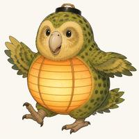 | 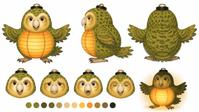 |
| [原寸](https://www.canva.com/M/MAHYoSCvgxY) | [原寸](https://www.canva.com/M/MAHYoSbQ7oo) |

- **生態ネタ**: カカポは飛べない夜行性の大型インコ。歩いて移動し、体から甘い匂いがする。
- **能力**: お腹の提灯が灯り、夜道で迷子を家まで歩いて送り届ける。灯りもほんのり甘く香る。
- **弱点**: 飛べないので遅い。雨に濡れると灯りが消える。
- **性格**: 人懐っこい、ドジ。
- **デザインの要点**: お腹が和紙と竹ひごの提灯、頭に黒い提灯の口輪。
- **配色**: 苔緑 / 提灯の橙 / 蜂蜜色

## 5. ウワサミミ — オオミミトビネズミ × 噂（概念）

| デザイン | リファレンス |
|---|---|
| 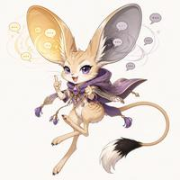 | 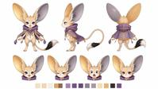 |
| [原寸](https://www.canva.com/M/MAHYoWV2xM4) | [原寸](https://www.canva.com/M/MAHYoXTmtHc) |

- **生態ネタ**: オオミミトビネズミは体に対して耳が極端に大きく、カンガルーのように跳ねる砂漠のネズミ。
- **能力**: 巨大な耳がまわりの噂を集める。本当の噂なら左耳が金色、嘘なら右耳が灰色に光る。
- **弱点**: 聞いた噂を言いたくて仕方がない。うるさい場所では耳が痛くなる。
- **性格**: おしゃべり、いたずら好きだが正義感が強い。
- **デザインの要点**: パラボラ状の大耳（左金・右灰）、吹き出し型の噂が耳に吸い込まれる、紫のケープ。
- **配色**: 砂色 / 噂の紫 / 金と灰

## 6. ハルネ — ヤマネ × 春の訪れ（事象）

| デザイン | リファレンス |
|---|---|
| 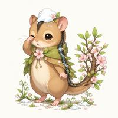 | 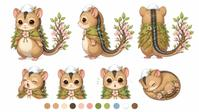 |
| [原寸](https://www.canva.com/M/MAHYoXLrViU) | [原寸](https://www.canva.com/M/MAHYoeo6tCo) |

- **生態ネタ**: ヤマネは背中に黒い 1 本線がある小さな冬眠動物（日本の天然記念物）。丸まって半年近く眠る。
- **能力**: 冬眠から目覚めた瞬間、まわりに春が来る。歩いた足跡から芽が出る。
- **弱点**: 寝坊すると春が遅れる。丸まって眠っている間はまわりに雪が降る。
- **性格**: 寝ぼすけ、穏やか。
- **デザインの要点**: 背中の黒線が雪解け水の小川、しっぽが若葉と桜の枝、頭に溶けかけの雪。
- **配色**: 栗色 / 若葉緑 / 桜色 / 雪白
