# 第2弾 候補 — Claude 版 v2「神秘」（2026-10-22）

`batch-002.md`（v1 パステル）と同じ 6 組を、仮スタイル v2「神秘」（`../AGENTS.md`）で作り直したもの。
設定（名前・能力・弱点・性格）は v1 と同じなので `batch-002.md` を見る。判定は `../CRITERIA.md` v0.2（A〜G）。
原寸は各リンク先（Canva）。`thumbs/v2-*` は 200px の縮小版。

| # | 名前 | 組み合わせ | A | B | C | D | E | F | G | 判定 | 理由 |
|---|---|---|---|---|---|---|---|---|---|---|---|
| 1 | ジョウロブタ | C01 ツチブタ × P01 じょうろ（道具） | | | | | | | | 候補 | |
| 2 | ケイトカピ | C02 オカピ × P02 毛糸玉（物） | | | | | | | | 候補 | |
| 3 | ユビキリハネ | C03 ハネジネズミ × P03 約束（概念） | | | | | | | | 候補 | |
| 4 | マヌルグモ | C04 マヌルネコ × P04 夕立（事象） | | | | | | | | 候補 | |
| 5 | ルーペジュー | C05 キンカジュー × P05 虫めがね（道具） | | | | | | | | 候補 | |
| 6 | トケイロリス | C06 スローロリス × P06 目覚まし時計（物） | | | | | | | | 候補 | |

Claude の所見:

- +α が光るので、v1 より **B（パッと分かる）が上がった**。特に約束（赤い糸の光の筋）と毛糸（光る毛糸玉）
- 服・帽子の禁止が効いて、v1 の探偵帽のような余計な小物は出なかった
- その代わり**マスコットらしさは下がり、リアル寄り**になった（特にツチブタ・ハネジネズミ）。D（日常に置ける）は下がる可能性がある
- リファレンスでも +α は 6 体とも残った（v1 ではツチブタのハス口が消えていた）

| # | デザイン | リファレンス |
|---|---|---|
| 1 | 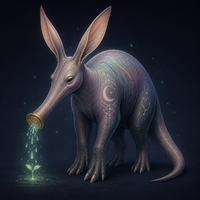 [原寸](https://www.canva.com/M/MAHYs1llMUk) | 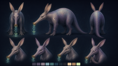 [原寸](https://www.canva.com/M/MAHYs47RZr0) |
| 2 | 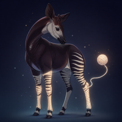 [原寸](https://www.canva.com/M/MAHYs1vg6UE) | 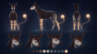 [原寸](https://www.canva.com/M/MAHYs9aRd3Y) |
| 3 | 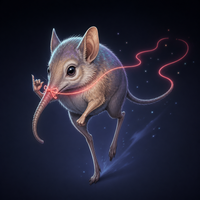 [原寸](https://www.canva.com/M/MAHYsxM_Koo) | 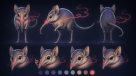 [原寸](https://www.canva.com/M/MAHYs72mKPE) |
| 4 | 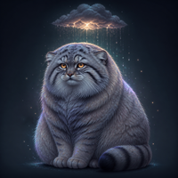 [原寸](https://www.canva.com/M/MAHYs_u8BCE) | 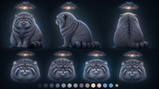 [原寸](https://www.canva.com/M/MAHYs1S5B4A) |
| 5 | 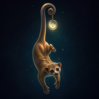 [原寸](https://www.canva.com/M/MAHYs1dDEUQ) | 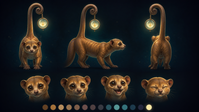 [原寸](https://www.canva.com/M/MAHYs318GqQ) |
| 6 | 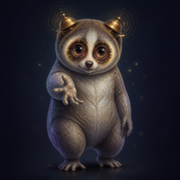 [原寸](https://www.canva.com/M/MAHYs6XfJ6o) | 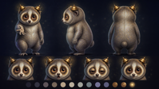 [原寸](https://www.canva.com/M/MAHYs7HIjQI) |
