# 第2弾 候補 — Claude 版（2026-10-21）

`AGENTS.md` の手順を Claude が Canva の画像生成で試したもの。Codex 版（`../batch-002.md`）と比べる用。
ラウンド 0 前半。判定は `../CRITERIA.md` の記号で付ける。原寸は各リンク先（Canva）にあり、`thumbs/` は 200px の縮小版。

| # | 名前 | 組み合わせ | A | B | C | D | E | F | 判定 | 理由 |
|---|---|---|---|---|---|---|---|---|---|---|
| 1 | ジョウロブタ | C01 ツチブタ × P01 じょうろ（道具） | | | | | | | 候補 | |
| 2 | ケイトカピ | C02 オカピ × P02 毛糸玉（物） | | | | | | | 候補 | |
| 3 | ユビキリハネ | C03 ハネジネズミ × P03 約束（概念） | | | | | | | 候補 | |
| 4 | マヌルグモ | C04 マヌルネコ × P04 夕立（事象） | | | | | | | 候補 | |
| 5 | ルーペジュー | C05 キンカジュー × P05 虫めがね（道具） | | | | | | | 候補 | |
| 6 | トケイロリス | C06 スローロリス × P06 目覚まし時計（物） | | | | | | | 候補 | |

Claude の自己チェック（A・B）: 6 体とも A は ○。B は 4〜6 が ○、1〜3 が △（+α が小さい、または概念で伝わりにくい）。

---

## 1. ジョウロブタ — ツチブタ × じょうろ

| デザイン | リファレンス |
|---|---|
| 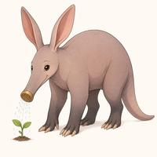 | 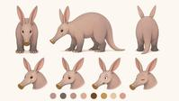 |
| [原寸](https://www.canva.com/M/MAHYqH32z2g) | [原寸](https://www.canva.com/M/MAHYqKF92nk) |

- **生態ネタ**: 夜に地面を掘り、アリやシロアリを食べる
- **+α の入れ方**: 長い鼻の先がじょうろのハス口（体の一部の置き換え）
- **能力**: 鼻から水をまき、しおれた植物を元気にする。地面を掘って水のありかを探し当てる
- **弱点**: 水を飲みすぎると鼻が重くなり、下を向いたまま歩けなくなる
- **性格**: 働き者、夜型
- **配色**: 桃灰色 / 真鍮 / 若葉緑
- ⚠️ リファレンスでハス口が消えた（E に影響）

## 2. ケイトカピ — オカピ × 毛糸玉

| デザイン | リファレンス |
|---|---|
| 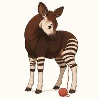 | 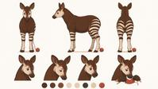 |
| [原寸](https://www.canva.com/M/MAHYqHDDkeA) | [原寸](https://www.canva.com/M/MAHYqBamiXI) |

- **生態ネタ**: キリンの仲間。長い舌で自分の耳まで掃除できる
- **+α の入れ方**: 脚のしま模様が毛糸編みで、ほどけた糸が毛糸玉につながる（置き換え + 持ち物）
- **能力**: 脚のしまの毛糸をほどいて、マフラーでも橋でも編める。ほつれは長い舌で直す
- **弱点**: 編むほど脚のしまが減り、寒くなる
- **性格**: 世話焼き、恥ずかしがり
- **配色**: チョコレート色 / クリーム白 / 毛糸の赤
- ⚠️ しまが「編み物」に見えにくい。+α は毛糸玉で伝わっている

## 3. ユビキリハネ — ハネジネズミ × 約束（概念）

| デザイン | リファレンス |
|---|---|
| 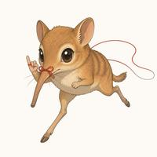 | 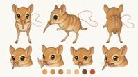 |
| [原寸](https://www.canva.com/M/MAHYqAEIbUY) | [原寸](https://www.canva.com/M/MAHYqLtNRHI) |

- **生態ネタ**: とても素早く走る。トガリネズミではなくゾウに近い系統
- **+α の入れ方**: 長い鼻に指切りの赤い糸を結び、小指を立てている（持ち物 + しぐさ）
- **能力**: 鼻の赤い糸が約束の相手につながっていて、誰より速く走って約束を届ける
- **弱点**: 約束が破られると糸がからまって動けなくなる
- **性格**: 律儀、せっかち
- **配色**: 砂色 / クリーム / 約束の赤

## 4. マヌルグモ — マヌルネコ × 夕立（事象）

| デザイン | リファレンス |
|---|---|
| 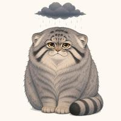 | 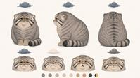 |
| [原寸](https://www.canva.com/M/MAHYqC0ESVg) | [原寸](https://www.canva.com/M/MAHYqBqSxOI) |

- **生態ネタ**: 寒い高地にすむ。瞳孔が縦長にならず丸い
- **+α の入れ方**: 頭の上に小さな雨雲（持ち物に近い付属物）
- **能力**: 機嫌が悪くなると頭上の雲から夕立が降る。毛が分厚いので自分は濡れない
- **弱点**: 機嫌がすぐ天気に出るので、隠しごとができない
- **性格**: 気難しいが根は優しい
- **配色**: スモークグレー / 雨の青 / 琥珀色の目

## 5. ルーペジュー — キンカジュー × 虫めがね

| デザイン | リファレンス |
|---|---|
| 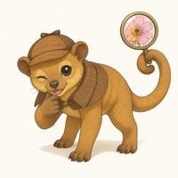 | 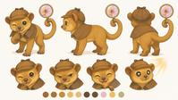 |
| [原寸](https://www.canva.com/M/MAHYqPUf9XA) | [原寸](https://www.canva.com/M/MAHYqLsn3zg) |

- **生態ネタ**: 夜行性。長い舌で花の蜜や果物を食べる
- **+α の入れ方**: 巻きつくしっぽで虫めがねを持つ（持ち物）
- **能力**: 虫めがねで、どんな小さな蜜や落とし物も見つける
- **弱点**: 夜行性なので昼はまぶしい。虫めがねが日光を集めてしまい、あちちになる
- **性格**: 探偵気取り、甘党
- **配色**: 蜂蜜色 / 真鍮 / 花のピンク
- ⚠️ 指定していない探偵帽とケープが付いた（探偵 = 虫めがね、の連想が強く出た）

## 6. トケイロリス — スローロリス × 目覚まし時計

| デザイン | リファレンス |
|---|---|
| 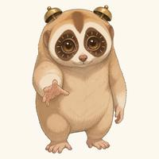 | 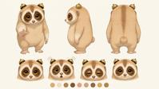 |
| [原寸](https://www.canva.com/M/MAHYqE9Mp5k) | [原寸](https://www.canva.com/M/MAHYqKZpse4) |

- **生態ネタ**: とてもゆっくり動く
- **+α の入れ方**: 目のまわりの模様が時計の文字盤、頭に小さなベル 2 つ（置き換え）
- **能力**: 頭のベルで、決まった時刻にまわりを起こす
- **弱点**: 自分は動きが遅く、鳴り終わるまでベルを止めに行けない
- **性格**: マイペースだが時間にはきっちり
- **配色**: ベージュ / こげ茶の模様 / 真鍮

---

## 画風の試し描き（ジョウロブタ）

| S1 仮スタイル | S2 図鑑寄りの水彩 | S3 日常アニメ寄り |
|---|---|---|
|  | 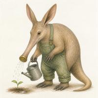 | 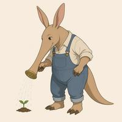 |
| [原寸](https://www.canva.com/M/MAHYqH32z2g) | [原寸](https://www.canva.com/M/MAHYqFLM7hI) | [原寸](https://www.canva.com/M/MAHYqGhpPzE) |

S2・S3 は指定していないのに、オーバーオールを着て二足で立つ姿になった。画風を変えると擬人化の度合いまで変わる。
